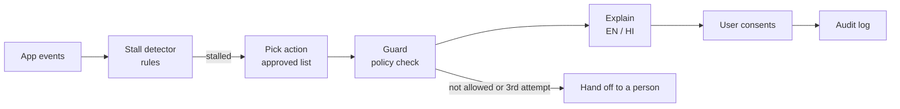
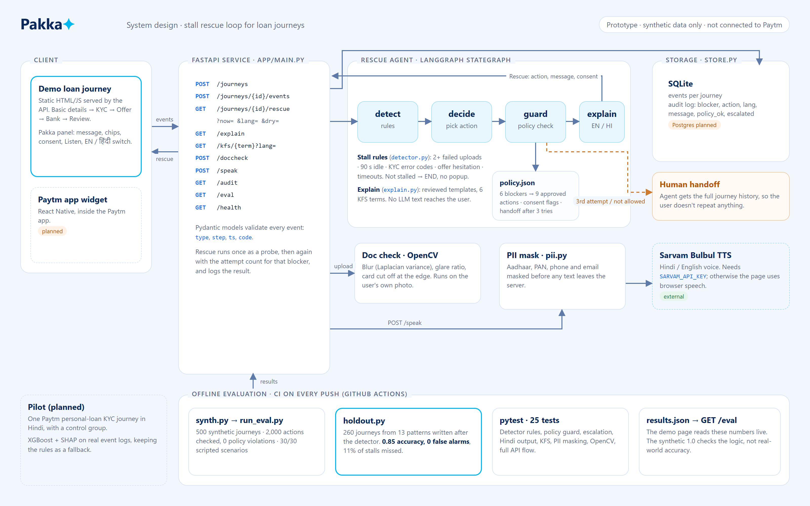
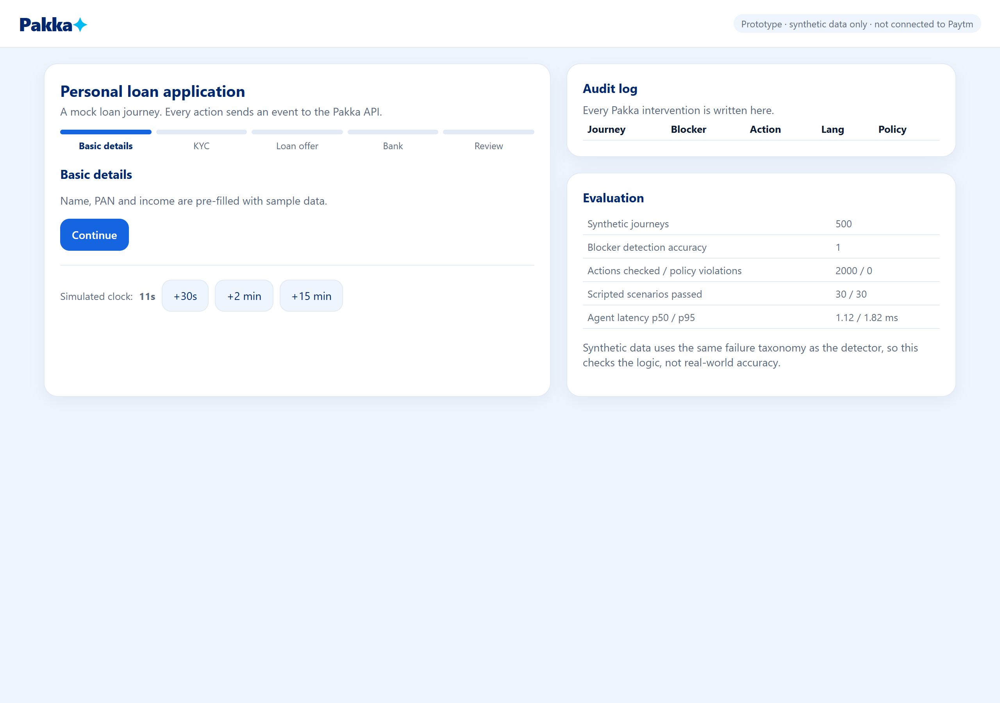
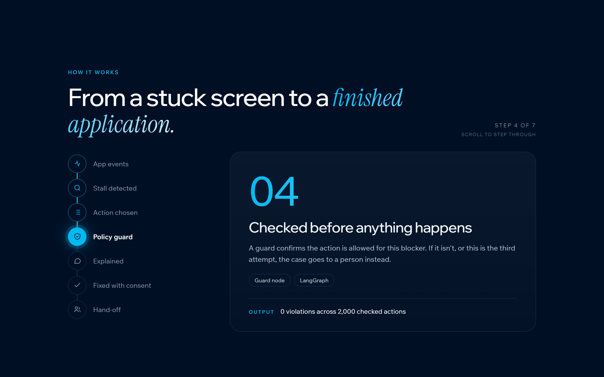
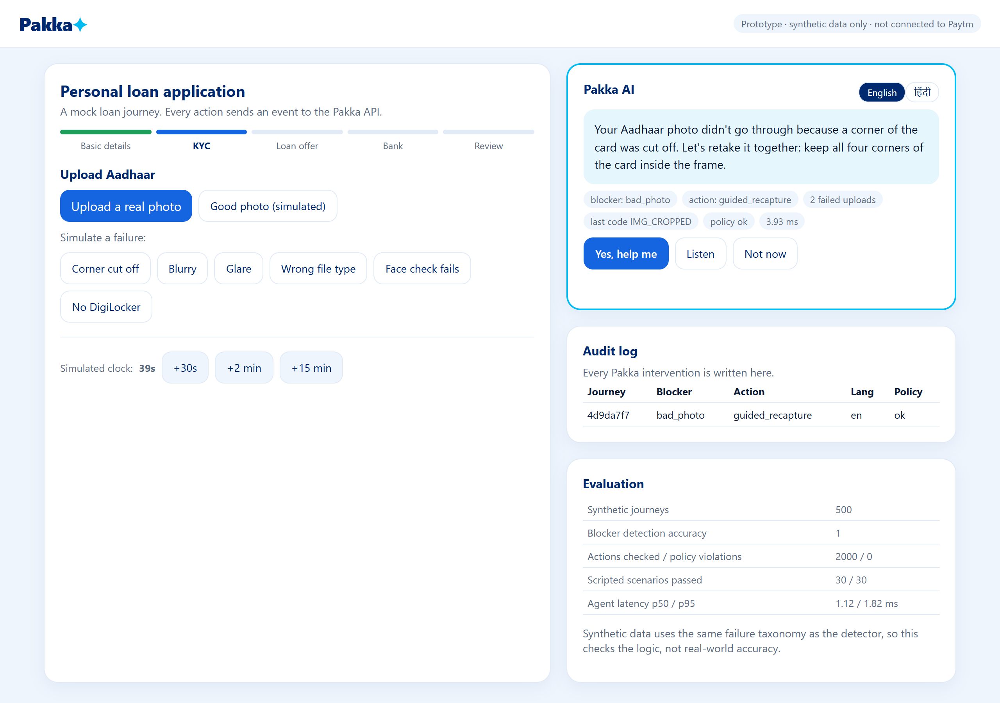
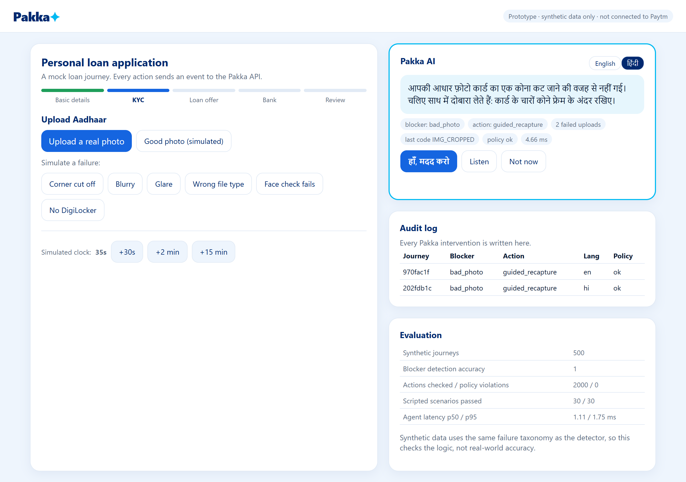
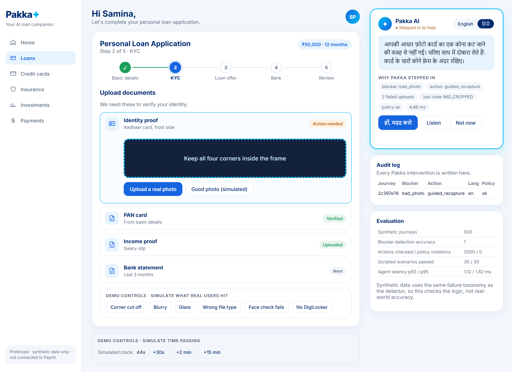
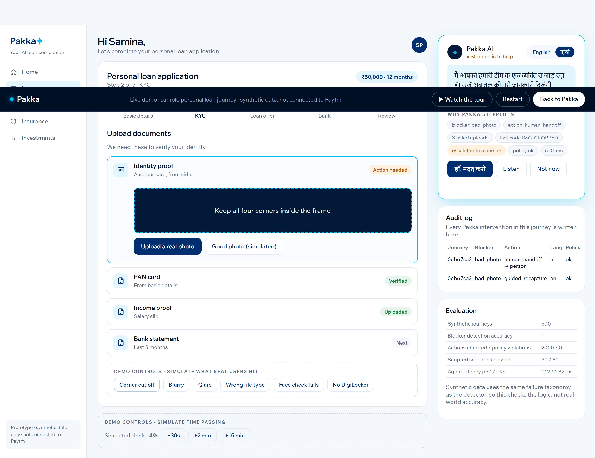
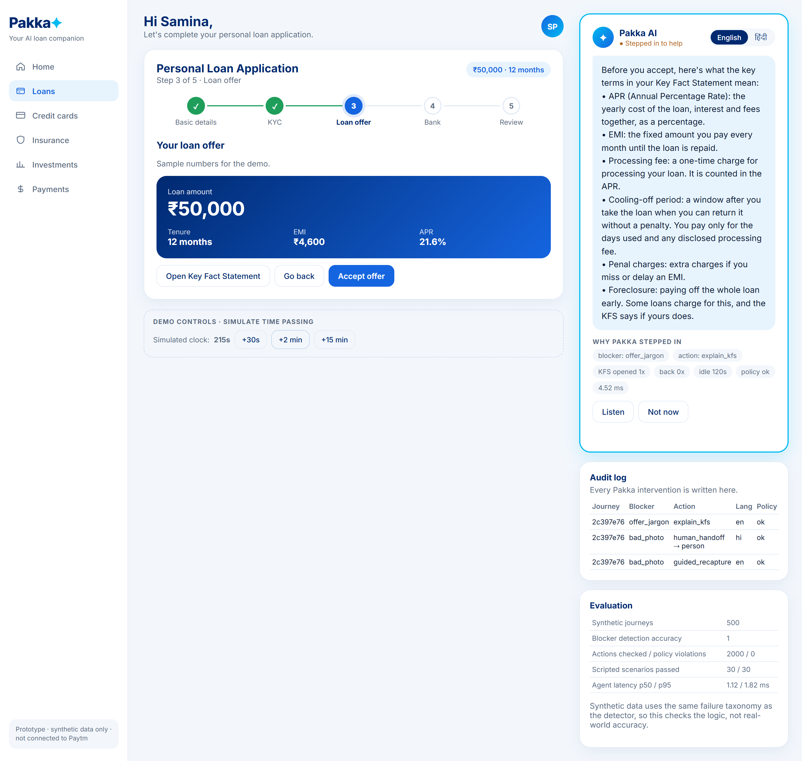
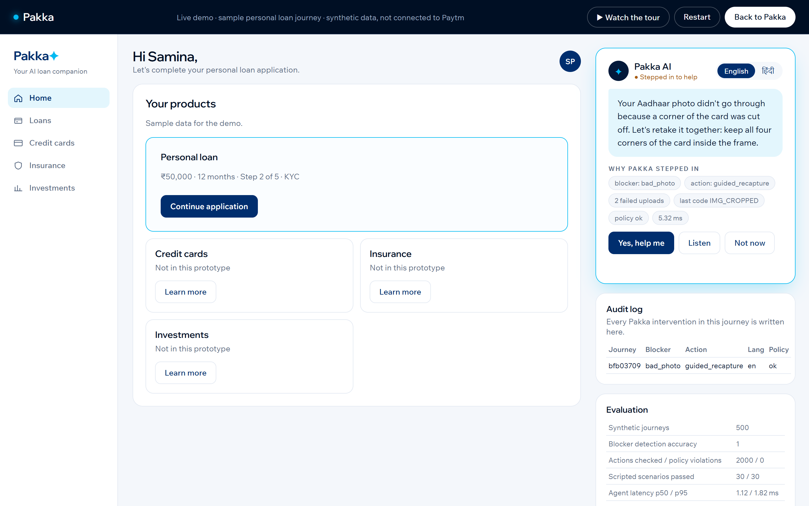

# Pakka ✦

**Team Queen** · Paytm Build for India AI Hackathon (Delhi) · Track 2: AI-Powered Financial Journeys

Pakka spots when someone is stuck in a loan application, tells them what went wrong in their own language, and helps them fix it. This repo is the working prototype of that rescue loop. It runs on synthetic data only and is not connected to Paytm.

```
spot it  →  explain it  →  fix it (with consent)  →  check it worked  →  hand off to a person if not
```

## What's in here

| Part | File | Status |
|---|---|---|
| Rule-based stall detector (2+ failed uploads, 90s idle, KYC error codes, offer hesitation, timeouts) | `pakka/detector.py` | Working |
| Approved-action policy: the agent can only pick from this list | `pakka/policy.json`, `pakka/policy.py` | Working |
| LangGraph agent: detect → decide → guard → explain | `pakka/agent.py` | Working |
| Explanations in English and Hindi, including six Key Fact Statement terms | `pakka/explain.py` | Working |
| Photo check with OpenCV (blur, glare, cut-off card) | `pakka/doccheck.py` | Working |
| PII masking before anything leaves the server | `pakka/pii.py` | Working |
| Audit log of every intervention (SQLite here, Postgres planned) | `pakka/store.py` | Working |
| FastAPI service and a demo loan journey page | `app/` | Working |
| Sarvam Bulbul voice | `pakka/sarvam.py` | Wired up, needs `SARVAM_API_KEY`; the page falls back to browser speech without it |
| XGBoost + SHAP stall model | | Planned for the pilot, once real event logs exist |
| React Native widget inside the Paytm app | | Planned |

The language model is deliberately kept out of the decision. Rules pick the action, the guard checks it against the approved list, and only then is the explanation written. In this prototype the explanations come from reviewed templates, so nothing a user hears is made up.



## System design



## Screenshots

The landing page explains the problem, who it helps and how it works, and plays a guided tour of the live app.

| Landing page | How it works |
|---|---|
|  |  |

Two failed Aadhaar uploads at KYC. Pakka explains what went wrong and offers a guided retake, in English or Hindi.

| Rescue (English) | Rescue (Hindi) |
|---|---|
|  |  |

The user accepts and gets a framing guide. One more failure and Pakka hands them to a person, and the audit log records each step.

| Guided retake | Handoff to a person |
|---|---|
|  |  |

On the loan offer, Pakka explains the Key Fact Statement terms when the user hesitates. The sidebar's Home tab shows where the application stands.

| Key Fact Statement explained | Home tab |
|---|---|
|  |  |

## Run it

```bash
pip install -r requirements.txt
python eval/run_eval.py          # builds eval/results.json
uvicorn app.main:app --reload    # open http://localhost:8000
```

Or with Docker: `docker build -t pakka . && docker run -p 8000:8000 pakka`

The landing page is at `/` and the live demo at `/demo`. Add `?tour=1` to watch the demo click through itself with captions.

To try it, open `/demo`, go to the KYC step and press **Corner cut off** twice. Pakka pops up with a fix in English or Hindi. Accept it, fail once more, and it hands you to a person. Use the clock buttons to test timeouts and the loan offer screen. **Upload a real photo** runs the OpenCV check on your own image.

For real Bulbul voice, copy `.env.example` to `.env` and set `SARVAM_API_KEY`.

## Evaluation

`python eval/run_eval.py` runs everything below and fails if any scripted scenario or policy check fails. CI runs it on every push.

| What we checked | Result |
|---|---|
| Synthetic journeys (5 failure types + 100 clean or near-miss) | 500 |
| Blocker detection accuracy | 1.00 |
| Agent actions checked against the approved list | 2,000, **0 violations** |
| Hand-written scenarios (expected blocker and action written by hand) | 30 / 30 passed |
| KFS terms explained, English and Hindi | 6 / 6 in both |
| Agent latency, p50 / p95 (no network) | ~1.1 ms / ~1.8 ms |

### Held-out test

`python eval/holdout.py` builds 260 journeys from 13 patterns written after the detector, which it was never tuned on: a PAN upload that works followed by Aadhaar failures, failures right at the 90-second line, someone fixing the problem and moving on, a brief look at the KFS, and so on.

| | Result |
|---|---|
| Accuracy | 0.85 |
| False alarms on users who were fine | 0% |
| Stuck users missed | 11% |

Two patterns fail, and we're leaving them visible rather than tuning the rules to pass:
1. One failed face check and then a long pause isn't flagged. The liveness rule needs two failures.
2. Two failed uploads and then a 10+ minute walk-away is labelled `timeout`, not `bad_photo`, so Pakka sends a resume link instead of a photo retake.

Please read the detection number carefully. The synthetic journeys are generated from the same failure taxonomy the detector uses, so 1.00 shows the rules do what we wrote, not how they'd do on real Paytm traffic. Near-miss journeys (one failed upload that then succeeds, a short pause on the offer screen) are included to check for false alarms. Real accuracy, and whether Pakka actually lifts completion, can only come from a pilot against a control group.

The handoff rate after three attempts is 0.8 rather than 1.0 because timeouts end in a callback offer, not a handoff.

## Tests

```bash
pytest -q
```

25 tests cover the detector rules, the policy guard, escalation, Hindi output, KFS coverage, PII masking, the OpenCV checks on generated card images, and the full API flow.

## API

| Method | Path | What it does |
|---|---|---|
| POST | `/journeys` | Start a journey |
| POST | `/journeys/{id}/events` | Send an app event (`step_view`, `upload_failed`, `kfs_open`, …) |
| GET | `/journeys/{id}/rescue?now=&lang=` | Run the agent; logs the intervention. Add `dry=true` to check without logging |
| POST | `/doccheck` | Check an uploaded ID photo |
| GET | `/kfs/{term}?lang=` | Plain-language KFS term |
| POST | `/speak` | Sarvam text-to-speech (needs a key) |
| GET | `/audit`, `/eval` | Audit log and evaluation results |

## What's next

1. Pilot on one Paytm journey (personal-loan KYC, Hindi) with a control group
2. Train XGBoost on real event logs, keep the rules as a fallback
3. App widget, KFS explainer on the offer screen, more languages through Sarvam
4. Postgres, Redis event stream, and consent records in production

## Team

Samina Parveen · Madhur Tandon · Aditya Karn
